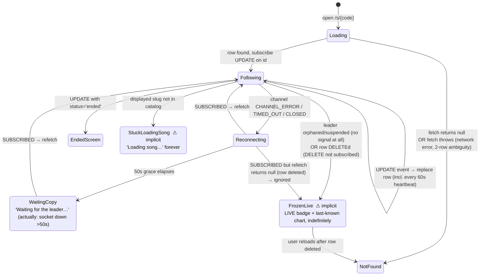

# Live Session lifecycle audit (Phase 0, read-only)

Audited at `deff6a7ed` (main, 2026-11-05). Only shipped code and migrations count
as evidence here. Repo docs were checked as claims. `AGENTS.md` and the per-app
sub-docs say nothing about Sessions. The only prose docs are the migration header
comments and `workers/session-cleanup/README.md`, and where they disagree with the
code this report says so.

**Surfaces involved.** The leader runs only on mobile. Two kinds of follower read
the session: the web viewer and the native app.

| Role | File |
|---|---|
| Schema | `supabase/migrations/20260720000000_sessions.sql`, `supabase/migrations/20260721000000_sessions_chord_code.sql` |
| Data access (shared) | `packages/core/src/sessions/sessionsRepo.js`, `packages/core/src/sessions/sessionCode.js` |
| Leader controller | `apps/mobile/src/lib/useSessionController.ts` |
| Leader UI | `apps/mobile/src/screens/PerformerScreen.tsx` (route `apps/mobile/app/perform/[id].tsx`) |
| Relaunch prompt | `apps/mobile/app/_layout.tsx:436-463` |
| Web follower | `apps/web/src/pages/SessionViewerPage.jsx` (route `apps/web/src/App.jsx:103`, `/s/:code`) |
| Native follower | `apps/mobile/src/screens/SessionFollowerScreen.tsx` (route `apps/mobile/app/session/[code].tsx`) |
| Cleanup | `workers/session-cleanup/index.js`, `workers/session-cleanup/wrangler.toml` |

Neither `apps/web/src` nor `apps/studio` calls `createSession`, `endSession` or
`touchSession`. The web app is only ever a follower.

---

## 1. State diagrams

### 1a. Session row and leader (what actually happens)

```mermaid
stateDiagram-v2
    [*] --> LiveAttached: Start session<br/>PerformerScreen.tsx:307 → useSessionController.ts:80 → sessionsRepo.js:116 (INSERT)

    state "LIVE · attached<br/>(Performer mounted, foreground;<br/>60s heartbeat + debounced broadcasts)" as LiveAttached
    state "LIVE · suspended<br/>(Performer mounted, app backgrounded / device asleep;<br/>JS timers paused, no writes)" as LiveSuspended
    state "LIVE · orphaned  ⚠ implicit<br/>(row says live, no leader process writing;<br/>followers still see LIVE + frozen item)" as LiveOrphaned
    state "ENDED<br/>(status='ended', row still readable)" as Ended
    state "DELETED<br/>(row gone; codes resolve to nothing)" as Deleted
    state "ZOMBIE LEADER  ⚠ implicit<br/>(leader UI shows Live, row deleted;<br/>every UPDATE matches 0 rows, no error)" as Zombie

    LiveAttached --> LiveSuspended: app backgrounded / screen locks
    LiveSuspended --> LiveAttached: foregrounded (interval resumes)
    LiveAttached --> LiveOrphaned: back out of Performer (unmount, no prompt)<br/>app killed · sign-out · end() write fails
    LiveSuspended --> LiveOrphaned: OS kills app in background
    LiveOrphaned --> LiveAttached: reopen Performer for same setlist AND row is controller's most-recent live row<br/>(adopt; position reset to item 1)
    LiveOrphaned --> Ended: relaunch prompt "End session" (_layout.tsx:456)
    LiveAttached --> Ended: menu "End session" succeeds (PerformerScreen.tsx:288)
    Ended --> Deleted: cleanup worker, ≤15 min (index.js:41)
    LiveOrphaned --> Deleted: worker, last_active_at < now−24h (index.js:43)
    LiveSuspended --> Deleted: worker, suspended >24h
    LiveSuspended --> Zombie: foregrounded after row was reaped
    LiveAttached --> Deleted: account deleted (FK ON DELETE CASCADE)
    LiveOrphaned --> Deleted: account deleted
    Ended --> LiveOrphaned: controller sets status='live' (RLS allows; no shipped code does it)
    Zombie --> [*]: leader taps End (0-row UPDATE "succeeds") or leaves screen
    Deleted --> [*]

    note right of LiveOrphaned
      If the cleanup worker is not deployed,
      LiveOrphaned and Ended are terminal:
      rows live forever.
    end note
```



What the leader-side states mean:

- **LIVE · attached.** `PerformerScreen` is mounted and `useSessionController`
  holds `session`. The heartbeat runs every 60 s (`useSessionController.ts:59-65`)
  and broadcasts are debounced by 250 ms (`useSessionController.ts:118-132`).
- **LIVE · suspended.** The screen is still mounted, but iOS has suspended the JS
  thread. `app.json` declares no background mode, so nothing keeps it awake.
  Keep-awake is a user preference and holds only while the screen is focused
  (`PerformerScreen.tsx:181-182`). No writes happen in this state.
- **LIVE · orphaned.** The row still says `live` but nothing writes to it.
  Shipped code reaches this state in six ways:
  1. Backing out of the Performer. Unmounting clears the interval
     (`useSessionController.ts:64`). There is no `beforeRemove` or
     `usePreventRemove` guard, and no end prompt.
  2. Killing the app.
  3. A failed `end()`. The `finally` block clears local state whether or not the
     write succeeded (`useSessionController.ts:109-113`).
  4. Signing out (`AccountScreen.tsx:180`). It never touches sessions.
  5. Starting a second session on another setlist (see §2.5).
  6. Deleting the setlist. `setlist_id` becomes NULL
     (`20260720000000_sessions.sql:44`), which means adoption
     (`useSessionController.ts:48`) and the Resume button (`_layout.tsx:449`)
     can never reattach to the row.

### 1b. Follower (web and native are the same machine)



---

## 2. Findings with references

### 2.1 Data model

**Table `public.sessions`** (`20260720000000_sessions.sql:41-55`, plus
`20260721000000_sessions_chord_code.sql:17`)

| Column | Type | Null | Default | Constraint |
|---|---|---|---|---|
| `id` | uuid | NOT NULL | `gen_random_uuid()` | PK |
| `code` | text | NOT NULL | (none; client supplies it) | UNIQUE (lyric-tier share code) |
| `chord_code` | text | NULL | (none; client supplies it) | UNIQUE via index; many NULLs allowed |
| `setlist_id` | uuid | NULL | (none) | FK → `setlists(id)` ON DELETE SET NULL |
| `controller_id` | uuid | NOT NULL | (none) | FK → `auth.users(id)` ON DELETE CASCADE |
| `status` | text | NOT NULL | `'live'` | CHECK in (`live`, `ended`) |
| `items` | jsonb | NOT NULL | `'[]'` | frozen snapshot; no size or shape check |
| `current_item_uid` | text | NULL | (none) | no FK; points into `items[].uid` |
| `transpose` | int | NOT NULL | `0` | no range check |
| `current_key` | text | NULL | (none) | |
| `created_at` | timestamptz | **NULL** | `now()` | |
| `updated_at` | timestamptz | **NULL** | `now()` | trigger `sessions_updated_at` BEFORE UPDATE (`:65-68`) |
| `last_active_at` | timestamptz | **NULL** | `now()` | client-written; no trigger |

Indexes:

- `sessions_code_idx` UNIQUE on `code`. This is redundant with the column's own
  UNIQUE constraint (`:57`).
- `sessions_controller_idx` on `controller_id` (`:58`).
- `sessions_status_active_idx` on `(status, last_active_at)` (`:59`).
- `sessions_chord_code_idx` UNIQUE on `chord_code`
  (`20260721000000_sessions_chord_code.sql:19`).

Other properties:

- `REPLICA IDENTITY FULL` is set (`:106`), and the table is added to the
  `supabase_realtime` publication (`:108-118`).
- There is **no participant or presence table**. Nothing records followers:
  `subscribeToSession` uses only `postgres_changes`, with no Realtime presence
  (`sessionsRepo.js:275-296`).
- **No partial unique index** of the form `(controller_id) WHERE status='live'`
  exists, so the database does not limit how many live sessions one leader can
  have.

**RLS** (`:77-98`). None of the policies has a `TO` clause, so each one applies
to every role.

- `sessions_select`: `FOR SELECT USING (true)`.
- `sessions_insert`: `FOR INSERT WITH CHECK (controller_id = auth.uid())`.
- `sessions_update`: `FOR UPDATE USING (controller_id = auth.uid()) WITH CHECK (controller_id = auth.uid())`.
- DELETE has no policy, so no client can delete. The worker uses the service
  role and bypasses RLS (`workers/session-cleanup/index.js:15-27`).

**Grants.** No migration contains a `GRANT` or `REVOKE` on `sessions`; I grepped
every file in `supabase/migrations/`. Effective privileges therefore come from
the project's default privileges. On stock Supabase that means `anon` and
`authenticated` hold full DML on the table, and only RLS gates them. This is
unverified for prod (see Unknowns).

**What an unauthenticated link holder can do:**

- **They can read every column of every session row, not just their own.**
  `USING (true)` has no row filter, and only the client narrows by code
  (`sessionsRepo.js:233`). The anon key ships in the web bundle, so
  `GET /rest/v1/sessions?select=*` lists every live and ended session with
  `code`, `chord_code`, `controller_id`, `setlist_id`, `items` and timestamps.
- **They can stream every session in real time.** Realtime `postgres_changes`
  applies the same SELECT policy. A client can subscribe to `table: 'sessions'`
  without the `id=eq.` filter. Because of `REPLICA IDENTITY FULL`, each event
  carries the full row.
- **They can read more than the viewer renders.** The viewer needs `items`,
  `current_item_uid`, `transpose`, `current_key` and `status`. It also receives:
  - `controller_id` (the leader's auth UUID) and `setlist_id`.
  - `chord_code`. A lyric-tier holder can therefore escalate to the chord tier.
    The migration says this is acceptable: "Chords are UX layering, not a
    security boundary" (`20260721000000_sessions_chord_code.sql:8-9`).
  - **Personal-song titles.** `buildSnapshot` writes the real `song.title` into
    `kind:'unavailable'` items (`sessionsRepo.js:56,61-62,68`). The comments
    describe these items as "no lyric embedding", which is true, but the title is
    included.
- **They cannot write.** INSERT fails because `controller_id` is NOT NULL and
  must equal `auth.uid()`, which is NULL for anon. UPDATE's `USING` clause
  matches no rows. DELETE has no policy. This analysis relies on RLS alone; the
  verification block in the migration (`:128-135`) is only a comment and may
  never have been run.

**What any signed-in user can write.** RLS allows all of the following, though
no shipped code does any of it:

- INSERT any number of sessions, with an arbitrary `items` payload, arbitrary
  `code` and `chord_code` values, and any `setlist_id`. The FK checks only that
  the setlist exists, not who owns it. No server-side code generation or format
  CHECK exists.
- UPDATE their own row's `code`, `chord_code`, `status`, `created_at` and
  `last_active_at`. Only `controller_id` is pinned.

### 2.2 Join code generation (`packages/core/src/sessions/sessionCode.js`)

- **Alphabet:** 31 characters, `23456789ABCDEFGHJKMNPQRSTUVWXYZ` (`:12`).
- **Length:** 6 (`:13`), giving 31⁶ ≈ 8.9 × 10⁸ codes per column.
- **RNG:** `Math.random()` (`:23`). This is not a CSPRNG.
- **Where codes come from:** the client generates them inside `createSession`,
  two per session (`sessionsRepo.js:112-113`).
- **Collisions:** the client retries up to 5 times on `23505`
  (`sessionsRepo.js:20,111-129`). It skips a row whose `code` equals its own
  `chord_code` (`:114`). Uniqueness is enforced per column only, so a session's
  `code` can equal **another** session's `chord_code`. In that case
  `fetchSessionByCode` runs `.or(code.eq.X,chord_code.eq.X).maybeSingle()`
  (`:233-234`), which errors on two rows, and the follower shows "Session not
  found" (`SessionViewerPage.jsx:100-101`).
- **Lookup:** `sanitizeCode` accepts `[A-Za-z0-9]+` (`sessionsRepo.js:25-27`),
  but `eq` is case-sensitive while codes are always uppercase. A hand-typed
  lowercase code therefore gets "not found".
- **Guessability:** this is moot. §2.1 shows that anyone can list every code, so
  nobody needs to guess one.

### 2.3 Every write site

| Op | Site | Writes |
|---|---|---|
| CREATE | `sessionsRepo.js:116-120`, called from `useSessionController.ts:80`, called from `PerformerScreen.tsx:307-310` | full row, `status='live'`, `current_item_uid=items[0].uid` |
| Position + transpose | `sessionsRepo.js:140-151`, called from `useSessionController.ts:126`, called from `PerformerScreen.tsx:167-174` | `current_item_uid`, `transpose`, `current_key`, `last_active_at` |
| Transpose only | `sessionsRepo.js:160-170` | exported, **never called** (grep finds no caller) |
| Heartbeat | `sessionsRepo.js:179-185`, called from `useSessionController.ts:61-62` every 60 s | `last_active_at` |
| END (Performer menu) | `sessionsRepo.js:194-200`, called from `useSessionController.ts:108`, called from `PerformerScreen.tsx:285-289` | `status='ended'`, `last_active_at` |
| END (relaunch prompt) | `sessionsRepo.js:194-200`, called from `_layout.tsx:456` | same; errors swallowed |
| DELETE (ended) | `workers/session-cleanup/index.js:41` | removes `status=eq.ended` |
| DELETE (stale) | `workers/session-cleanup/index.js:43` | removes `last_active_at < now−TTL` (any status) |
| DELETE (cascade) | `20260720000000_sessions.sql:45`, via `delete_user()` from `AccountScreen.tsx:195` | removes all of the user's rows |
| Reads | `sessionsRepo.js:227-239` (by code), `:248-262` (leader's latest live row) | |

### 2.4 The end and resume prompts

The leader sees two separate prompts. Neither one appears when leaving a set.

1. **Performer session menu.** `PerformerScreen.tsx:280-293` builds it, and the
   header session button opens it (`:298-301`). It also opens straight after a
   successful start (`:309`). Its options are "Share team link (chords)", "Share
   participant link (lyrics)", "End session" and "Cancel".
   - **End session** calls `sessionCtl.end()`, which runs
     `UPDATE status='ended', last_active_at=now()`. On failure the alert shows
     "Could not end session" (`:288`). Local state has already been cleared
     (`useSessionController.ts:109-113`), so the button now reads "Start
     session" and the leader cannot retry. The row stays `live` until the 24 h
     TTL reaps it.
2. **"Resume live session?" on relaunch** (`_layout.tsx:436-463`, strings in
   `apps/mobile/src/i18n/locales/en/setlist.json` under `resume`). It runs once
   per JS process: `resumeChecked` is a ref (`:272`) that is set true at `:441`.
   It needs `ready && session`, so it waits for sign-in. It queries
   `fetchActiveSessionForController`, which returns only the single most
   recently updated live row and does not filter on `last_active_at`
   (`sessionsRepo.js:252-259`).
   - **Resume** runs `router.push('/perform/{setlist_id}')`, and only if
     `setlist_id` is non-null (`:449`). Nothing touches the row. The Performer
     then adopts the row only if it is still the controller's most recent live
     row **and** its `setlist_id` matches (`useSessionController.ts:43-56`).
     After adopting, `index` starts at 0 (`PerformerScreen.tsx:87`). The
     broadcast effect then sends `i0` (`:167-174`) because `lastSent` is empty,
     so **followers jump back to item 1 and transpose resets.** When
     `setlist_id` is NULL, Resume does nothing at all.
   - **End session** runs `endSession(row.id)` with errors silently swallowed
     (`:456`).
   - **Later** does nothing. The row stays live with no heartbeat.
   - The prompt is **not** shown on warm foreground, only on cold launch or the
     first sign-in of a process.

### 2.5 Behaviour under each event

| Event | What happens to the row | What followers see |
|---|---|---|
| Leader leaves the set (back out of Performer) | Nothing is written. The interval is cleared on unmount (`useSessionController.ts:64`). The row is orphaned and `last_active_at` freezes. | LIVE plus the last item, indefinitely (§1b FrozenLive). |
| Leader taps End (success) | `status='ended'` | "Thanks for joining our session!" (`SessionViewerPage.jsx:234-246`; native `SessionFollowerScreen.tsx:305-320`). |
| App backgrounded / device sleeps | No writes while JS is suspended. Pending debounced broadcasts and the heartbeat resume on foreground (the component is still mounted). | Frozen on the last item. The socket is still up, so no banner appears. |
| App killed | Orphaned. Resume prompt on next cold launch, if the row is <24 h old (or the worker isn't running) and is the latest live row. | FrozenLive |
| Network loss (leader) | Failed broadcasts are swallowed (`useSessionController.ts:130`). **`lastSent` is set before the write** (`:125`), so the failed position is **not resent when the network returns.** The heartbeat (`:62`) does not carry position, and the next send happens only when the leader changes song or key. | Stuck on the pre-outage item even after the leader reconnects. |
| Network loss (follower) | n/a | "Reconnecting…", then after 50 s "Waiting for the leader…" (`SessionViewerPage.jsx:24,137-146,299-303`). On `SUBSCRIBED` the follower refetches. A null result (row deleted) is ignored (`:121-122`). |
| Sign-out | Nothing. `AccountScreen.tsx:180` only calls `auth.signOut()`. If the Performer is still mounted, its heartbeat now runs as anon and UPDATEs 0 rows without error. | FrozenLive |
| Account deleted | Hard-deleted by the cascade. | FrozenLive (DELETE events are not subscribed, `sessionsRepo.js:281`). |
| Setlist deleted | `setlist_id` becomes NULL. Leader can never re-adopt the row and Resume is a no-op. | Continues from the snapshot until orphaned. |
| Row reaped while leader is attached or suspended | Leader keeps writing. Every UPDATE matches 0 rows, and PostgREST returns success, so the leader UI still says Live. | Viewers that reload get "Session not found". |

### 2.6 How position reaches followers

- **Mechanism:** Supabase Realtime `postgres_changes`, UPDATE only, on channel
  `session:{id}` filtered by `id=eq.{id}` (`sessionsRepo.js:275-288`). There is
  no broadcast channel, no presence and no polling. The native follower also
  refetches when the app returns to the foreground
  (`SessionFollowerScreen.tsx:156-165`).
- **Every heartbeat is a full event for every follower.** Each 60 s
  `touchSession` is an UPDATE, so each follower receives the full row, including
  the whole `items` jsonb.
- **When updates stop, the follower has no way to notice.** It never reads
  `last_active_at`. It is fetched (`sessionsRepo.js:232`) but no viewer uses it.
  The follower has only socket status. An orphaned or suspended leader leaves
  the socket healthy, so the follower shows **LIVE plus the last item with no
  banner, indefinitely.** The "Waiting for the leader…" text reflects only the
  follower's own socket being down for more than 50 s. It says nothing about the
  leader.
- **A missing current item falls back silently.** If `current_item_uid` doesn't
  match any snapshot item, both viewers show `items[0]`
  (`SessionViewerPage.jsx:162`; `SessionFollowerScreen.tsx:193`). This happens
  when the setlist is edited after start, because the leader maps
  `index → i${index}` against the *current* setlist (`PerformerScreen.tsx:170`)
  while the snapshot stays frozen.

### 2.7 Multiple active sessions per leader

**Yes, a leader can have several.** The database has no constraint against it.
The only guard is `if (sessionRef.current || busy) return`
(`useSessionController.ts:76`), and that is per mounted screen. Adoption picks a
single "most recent live" row and requires its `setlist_id` to match
(`:45-50`).

Reproduction:

1. Start a session on setlist A.
2. Back out.
3. Start a session on setlist B. There are now two live rows.
4. Reopen A. `fetchActiveSessionForController` returns B, so nothing is adopted,
   and Start creates a third row.

Each code still resolves only to its own row, because codes are per session
(`sessionsRepo.js:233`). Old links for A show the frozen last state with LIVE
until the TTL reaps them. The relaunch prompt only ever offers the most recent
row, so the others cannot be ended from the UI.

The same setlist on two devices under one account produces two writers on one
row: device 2 adopts device 1's row, both heartbeat, and the last write wins.

There is also a **race on Performer mount.** The adoption fetch is async (`:45`).
If the leader taps Start before it resolves, a new row is created, and the late
adoption result can then overwrite `session` with a different row.

### 2.8 Expiry and cleanup

**The only cleanup is a Cloudflare cron Worker,** `workers/session-cleanup`. It
runs every 15 minutes (`wrangler.toml:12-13`) with `SESSION_TTL_HOURS="24"`
(`:16`). Each run does two passes:

- **Pass 1** deletes `status=eq.ended` (`index.js:41`).
- **Pass 2** deletes `last_active_at=lt.<now−24h>` (`index.js:43`). This pass has
  no status filter, and its `lt` comparison never matches a NULL
  `last_active_at`.

Nothing else exists:

- No migration creates a `pg_cron` job, trigger or function on `sessions`.
- No GitHub Action deploys the Worker (`.github/workflows/`: `db-backup`,
  `feature-post`, `pr-checks`, `prod-smoke`, `wiki-sync`). The README tells you
  to run `wrangler deploy` by hand (`workers/session-cleanup/README.md:20-25`).
- The Worker logs failures with `console.error` and does not alert
  (`index.js:52-54`).

**The docs contradict the Worker.** The migration says "Ended rows stay readable
so late/lingering followers can render the end screen"
(`20260720000000_sessions.sql:79-80`). But the Worker deletes ended rows within
15 minutes. Anyone who opens the link more than about 15 minutes after End gets
"Session not found" instead of the end screen.

**What a viewer sees when opening a link:**

| Row state | Web (`SessionViewerPage.jsx`) | Native (`SessionFollowerScreen.tsx`) |
|---|---|---|
| `ended` (row present) | "Thanks for joining our session!" end screen (`:234-246`) | ended screen (`:305-320`) |
| deleted / never existed | "Session not found. This session may have ended or the link is incorrect." (`:223-232`) | notFound screen (`:285-300`) |
| live but stale (leader gone) | **LIVE badge + last item, no warning** (§2.6) | same |
| fetch error (offline, 5xx, ambiguous code) | **"Session not found"**, the same as deleted (`:100-101`) | same (`:117-119`) |
| deleted *while* viewing | **stays on LIVE + last chart**; reconnect refetch null ignored (`:121-122`) | same (`:138-140`, `:159-161`) |
| displayed song slug absent from catalog, or catalog not loaded / failed | **"Loading song…" forever** (`:358-360`) | `loadingSong` spinner (`:437-441`) |

---

## 3. Unknowns (not resolvable by reading)

1. **Is the schema live in prod?** Memory notes that the live DB has drifted
   from the migrations. Nothing here proves that `sessions`, `chord_code`, the
   RLS policies, `REPLICA IDENTITY FULL` and publication membership exist as
   written. The pre-flight queries in §5 check this.
2. **Effective grants on `sessions`** for `anon` and `authenticated` in prod.
   They depend on project default privileges, because no migration sets them.
3. **Is the cleanup Worker deployed?** Also unknown: whether its secrets are set,
   whether the cron is firing, what TTL is actually in effect, and whether runs
   are succeeding. Nothing in the repo deploys it, and its logs live only in
   Cloudflare. The §5 counts are diagnostic here: any `live` row older than 24 h,
   or any `ended` row older than 15 minutes, means it isn't running.
4. **Out-of-repo jobs.** I could not see whether any dashboard-created `pg_cron`
   job, Database Webhook or Edge Function touches `sessions`. §5 includes a
   `cron.job` check.
5. **Realtime project configuration.** I could not see whether RLS enforcement
   for `postgres_changes` is on (it is the default for new projects), or what
   channel and message limits apply. This affects the "anyone can stream every
   session" finding.
6. **Exact OS suspension timing.** No `UIBackgroundModes` is set in
   `apps/mobile/app.json`, so iOS suspension is expected, but the timing is
   device-dependent. Android timer throttling is also device- and
   vendor-dependent.
7. **Does sign-out unmount the Performer?** If the Performer is in the stack
   below the screen where sign-out happens, does `router.replace('/login')`
   (`_layout.tsx:126`) unmount it? This decides whether the 0-row anon heartbeat
   actually happens.
8. **Supabase client behaviour on JWT expiry mid-session.** Auto-refresh is
   AppState-driven (`apps/mobile/src/lib/supabase.ts:88-99`). I could not
   confirm whether a long-suspended leader's first heartbeat goes out with an
   expired token, which would be a 401, swallowed.
9. **Historical data.** I don't know whether any rows were created before
   `chord_code` existed (NULL `chord_code`), or whether any leader has ever had
   two or more live rows at once. §5 covers both.

---

## 4. Bugs and leaks (recorded only, not fixed)

| # | Severity | Finding | Ref |
|---|---|---|---|
| B1 | High (privacy) | Anyone with the public anon key can list and stream **all** sessions: codes, chord codes, leader UUIDs, setlist ids, snapshots. `SELECT USING (true)` with no row scoping. | `20260720000000_sessions.sql:81-83`; `sessionsRepo.js:233` |
| B2 | Medium (privacy) | Personal-song titles are published to anon in `items[].title` for `unavailable` items, contrary to the "no lyric embedding / placeholder" framing. | `sessionsRepo.js:56,61-62,68` |
| B3 | High (UX) | No leader-liveness signal on followers. An orphaned or suspended leader shows as LIVE with a frozen chart indefinitely. `last_active_at` is fetched and ignored. | `SessionViewerPage.jsx:148-158,299-303`; `SessionFollowerScreen.tsx:178-189` |
| B4 | High (UX) | Leaving the Performer orphans the session silently. There is no end prompt, and no end on unmount. | `useSessionController.ts:58-72`; `PerformerScreen.tsx` (no `beforeRemove`) |
| B5 | High | A position broadcast that fails during a leader network blip is never retried. `lastSent` is committed before the write and the error is swallowed. | `useSessionController.ts:124-131` |
| B6 | Medium | Resume or adoption yanks followers back to item 1 with transpose 0. The leader's position isn't restored from the row. | `PerformerScreen.tsx:87,167-174`; `useSessionController.ts:43-56` |
| B7 | Medium | A failed End clears local state anyway. The row stays live, the UI offers "Start session", and End can't be retried. | `useSessionController.ts:103-114` |
| B8 | Medium | Multiple live sessions per leader. Adoption and the relaunch prompt only see the newest row, so older rows can't be ended from the UI. There is no DB constraint. | `useSessionController.ts:45-50,76`; `sessionsRepo.js:252-259` |
| B9 | Medium | Followers don't subscribe to DELETE, and they ignore a null refetch on reconnect. A reaped, cascaded or cleaned row leaves viewers on LIVE forever. | `sessionsRepo.js:281`; `SessionViewerPage.jsx:121-122`; `SessionFollowerScreen.tsx:138-140,159-161` |
| B10 | Medium | A zombie leader appears after a reap: every UPDATE matches 0 rows and returns success, so the leader UI says Live. | `sessionsRepo.js:140-200` (no `.select()` / row-count check) |
| B11 | Medium | The end screen disappears within 15 minutes because the Worker deletes ended rows, contradicting the migration's stated intent. Late openers see "not found". | `index.js:41` vs `20260720000000_sessions.sql:79-80` |
| B12 | Low–Med | Network errors and ambiguous lookups both render "Session not found", indistinguishable from a dead session. | `SessionViewerPage.jsx:98-102`; `SessionFollowerScreen.tsx:115-119` |
| B13 | Low | A cross-column code collision is possible (`code` of A equal to `chord_code` of B). It makes `.maybeSingle()` error and both sessions show "not found". | `sessionsRepo.js:111-115,233-234`; separate per-column indexes |
| B14 | Low | Codes come from `Math.random()` and are client-chosen. Any signed-in user can INSERT arbitrary codes, or UPDATE their own row's `code` to a recently reaped code and take over old shared links. Content is limited to snapshot items, though `title` text is arbitrary. | `sessionCode.js:23`; `20260720000000_sessions.sql:87-96` |
| B15 | Low | The controller can set `status` back to `'live'` or set `last_active_at` to the future or NULL. NULL or future values are never reaped. | `20260720000000_sessions.sql:92-96`; `index.js:43` |
| B16 | Low | Unbounded INSERTs: no per-user cap, no `items` size limit, no rate limit. | `20260720000000_sessions.sql:87-88` |
| B17 | Low | Snapshot drift: editing the setlist mid-session breaks the index→uid mapping, and followers silently fall back to `items[0]`. | `PerformerScreen.tsx:170`; `SessionViewerPage.jsx:162` |
| B18 | Low | "Loading song…" spins forever when the slug isn't in the follower catalog (song soft-deleted after start, or catalog fetch failed). | `SessionViewerPage.jsx:166-176,358-360` |
| B19 | Low | Deleting the setlist makes the session unrecoverable: Resume is a no-op and adoption can never match. | `_layout.tsx:449`; `useSessionController.ts:48` |
| B20 | Low (efficiency) | Every 60 s heartbeat pushes the full row, including `items`, to every follower over Realtime. | `useSessionController.ts:59-65`; `20260720000000_sessions.sql:106` |
| B21 | Info | A Performer-mount race: Start tapped before the adoption fetch resolves can create a row and then be overwritten by the adopted one. | `useSessionController.ts:43-56,74-89` |
| B22 | Info | `updateTranspose` is dead code. `sessions_code_idx` duplicates the column's UNIQUE constraint. | `sessionsRepo.js:160-170`; `20260720000000_sessions.sql:43,57` |
| B23 | Info | Relaunch prompt: ended-session errors are swallowed, and it is shown for rows hours stale (no `last_active_at` filter). | `_layout.tsx:456`; `sessionsRepo.js:252-259` |

---

## 5. SQL to run manually (read-only)

Run in the Supabase SQL editor. Every statement is a `SELECT`.

"Leader activity" is taken as
`COALESCE(last_active_at, updated_at, created_at)`. Every leader write also bumps
`updated_at` through the trigger, and `last_active_at` is client-written and
nullable.

```sql
-- =====================================================================
-- 0. PRE-FLIGHT — does prod match the migrations? (resolves Unknowns 1, 2, 4, 5)
-- =====================================================================
SELECT to_regclass('public.sessions') AS sessions_table;   -- NULL => table absent; stop here

SELECT column_name, data_type, is_nullable, column_default
FROM information_schema.columns
WHERE table_schema = 'public' AND table_name = 'sessions'
ORDER BY ordinal_position;

SELECT indexname, indexdef FROM pg_indexes
WHERE schemaname = 'public' AND tablename = 'sessions';

SELECT polname, polcmd, polroles::regrole[] AS roles,
       pg_get_expr(polqual, polrelid)      AS using_expr,
       pg_get_expr(polwithcheck, polrelid) AS with_check
FROM pg_policy WHERE polrelid = 'public.sessions'::regclass;

SELECT relrowsecurity, relforcerowsecurity,
       CASE relreplident WHEN 'f' THEN 'FULL' WHEN 'd' THEN 'DEFAULT'
                         WHEN 'n' THEN 'NOTHING' WHEN 'i' THEN 'INDEX' END AS replica_identity
FROM pg_class WHERE oid = 'public.sessions'::regclass;

SELECT grantee, string_agg(privilege_type, ', ' ORDER BY privilege_type) AS privileges
FROM information_schema.role_table_grants
WHERE table_schema = 'public' AND table_name = 'sessions'
GROUP BY grantee ORDER BY grantee;

SELECT pubname FROM pg_publication_tables
WHERE schemaname = 'public' AND tablename = 'sessions';

SELECT tgname, pg_get_triggerdef(oid) FROM pg_trigger
WHERE tgrelid = 'public.sessions'::regclass AND NOT tgisinternal;

-- Any DB-side scheduler? If this returns a row, run the cron.job query below it.
SELECT extname, extversion FROM pg_extension WHERE extname IN ('pg_cron', 'pg_net');
-- SELECT jobid, schedule, command, active FROM cron.job WHERE command ILIKE '%session%';

-- =====================================================================
-- 1. Rows that APPEAR active (status='live') but have had no leader activity
--    in >24h / >7d / >30d (buckets are cumulative).
--    Non-zero >24h  ⇒ the cleanup Worker is not running (or failing).
-- =====================================================================
SELECT
  count(*)                                                                      AS live_total,
  count(*) FILTER (WHERE COALESCE(last_active_at, updated_at, created_at) < now() - interval '24 hours') AS idle_gt_24h,
  count(*) FILTER (WHERE COALESCE(last_active_at, updated_at, created_at) < now() - interval '7 days')   AS idle_gt_7d,
  count(*) FILTER (WHERE COALESCE(last_active_at, updated_at, created_at) < now() - interval '30 days')  AS idle_gt_30d,
  count(*) FILTER (WHERE last_active_at IS NULL)                                AS null_last_active,   -- never reaped (B15)
  count(*) FILTER (WHERE last_active_at > now() + interval '5 minutes')         AS future_last_active  -- never reaped (B15)
FROM public.sessions
WHERE status = 'live';

-- Also: ended rows the Worker should have deleted (>15 min old ⇒ Worker not running).
SELECT count(*) AS ended_rows_total,
       count(*) FILTER (WHERE COALESCE(last_active_at, updated_at) < now() - interval '20 minutes') AS ended_older_than_20m
FROM public.sessions
WHERE status = 'ended';

-- =====================================================================
-- 2. Oldest still-active session
-- =====================================================================
SELECT id, code, chord_code, controller_id, setlist_id,
       created_at, updated_at, last_active_at,
       now() - created_at                                            AS age,
       now() - COALESCE(last_active_at, updated_at, created_at)      AS idle_for,
       jsonb_array_length(items)                                     AS item_count
FROM public.sessions
WHERE status = 'live'
ORDER BY created_at ASC NULLS FIRST
LIMIT 1;

-- =====================================================================
-- 3. Distribution of session age at end, for sessions ended explicitly.
--    endSession() sets last_active_at = now() at the moment of ending
--    (sessionsRepo.js:197), so age_at_end = last_active_at - created_at.
--    CAVEAT: the Worker deletes ended rows within ~15 min, so if it is running
--    this will only see the last ~15 minutes of ends (likely 0 rows). There is no
--    history table — an empty result here is expected, not "no one ends sessions".
-- =====================================================================
WITH ended AS (
  SELECT COALESCE(last_active_at, updated_at) - created_at AS age_at_end
  FROM public.sessions
  WHERE status = 'ended' AND created_at IS NOT NULL
)
SELECT
  count(*)                                                        AS n,
  min(age_at_end)                                                 AS min,
  percentile_cont(0.25) WITHIN GROUP (ORDER BY age_at_end)        AS p25,
  percentile_cont(0.50) WITHIN GROUP (ORDER BY age_at_end)        AS p50,
  percentile_cont(0.75) WITHIN GROUP (ORDER BY age_at_end)        AS p75,
  percentile_cont(0.95) WITHIN GROUP (ORDER BY age_at_end)        AS p95,
  max(age_at_end)                                                 AS max
FROM ended;

WITH ended AS (
  SELECT EXTRACT(EPOCH FROM COALESCE(last_active_at, updated_at) - created_at) / 60.0 AS mins
  FROM public.sessions
  WHERE status = 'ended' AND created_at IS NOT NULL
)
SELECT bucket, count(*) AS n
FROM (
  SELECT CASE
    WHEN mins <    5 THEN '1: <5m'
    WHEN mins <   30 THEN '2: 5–30m'
    WHEN mins <   60 THEN '3: 30–60m'
    WHEN mins <  120 THEN '4: 1–2h'
    WHEN mins <  240 THEN '5: 2–4h'
    WHEN mins < 1440 THEN '6: 4–24h'
    ELSE                  '7: ≥24h'
  END AS bucket
  FROM ended
) b
GROUP BY bucket ORDER BY bucket;

-- =====================================================================
-- 4. Supporting checks for specific findings
-- =====================================================================
-- B8: leaders with >1 live session right now
SELECT controller_id, count(*) AS live_sessions,
       min(created_at) AS oldest, max(created_at) AS newest
FROM public.sessions WHERE status = 'live'
GROUP BY controller_id HAVING count(*) > 1
ORDER BY live_sessions DESC;

-- B13: cross-column code collisions (a code that is both some row's code and another row's chord_code)
SELECT a.code AS shared_value, a.id AS lyric_row, b.id AS chord_row
FROM public.sessions a JOIN public.sessions b
  ON a.code = b.chord_code AND a.id <> b.id;

-- B19: live sessions whose setlist was deleted (unrecoverable from the UI)
SELECT count(*) AS live_with_null_setlist
FROM public.sessions WHERE status = 'live' AND setlist_id IS NULL;

-- Pre-chord-code rows still present
SELECT count(*) AS rows_without_chord_code FROM public.sessions WHERE chord_code IS NULL;
```
